# go-ringbufferlib

[](https://pkg.go.dev/github.com/barnowlsnest/go-ringbufferlib/pkg/ringbuffer)
[](https://github.com/barnowlsnest/go-ringbufferlib/actions/workflows/build.yml)
[](https://github.com/barnowlsnest/go-ringbufferlib/actions/workflows/lint.yml)
[](LICENSE)

A fixed-capacity byte ring buffer for Go. It is safe for concurrent use and implements `io.Reader`, `io.Writer` and `io.Closer`, so it works with `io.Copy` and anything else that streams bytes. It also has the familiar `bytes.Buffer` helpers: `ReadByte`, `ReadRune`, `WriteByte`, `WriteString`, `WriteRune`, `String`, `Len`, `Cap`, `Available`, `Reset` and `Truncate`.

- **Two write modes:** keep only the newest bytes (overwrite), or block until readers make room (backpressure).
- **Blocking or non-blocking reads:** return `ErrEmpty` right away, or wait for data.
- **Stall timeouts:** a blocked call gives up with `ErrTimeout` after a set time without progress, without limiting how long a healthy stream runs.
- **Cancellation:** tie the buffer to a `context.Context` to stop a stream and wake every blocked call.
- **Graceful shutdown:** `Close` can drain what's left before it returns, with a timeout.
- **Zero allocations** on the `Write`/`Read` hot path, including blocked calls with a timeout set: each buffer creates its two wake-up timers once and reuses them.
- **No runtime dependencies:** the package imports only the standard library.

## How it works



## Install

```sh
go get github.com/barnowlsnest/go-ringbufferlib/pkg/ringbuffer
```

Requires Go 1.27 or later.

## Usage

### Keep only the newest bytes

By default, `Write` never blocks. When the buffer is full, it drops the oldest unread bytes, which suits recent-log tails, metrics windows and similar.

```go
func latestLog() error {
	rb := ringbuffer.New(8)
	for _, entry := range []string{"old-log;", "new-log;"} {
		if _, err := rb.Write([]byte(entry)); err != nil {
			return fmt.Errorf("write %q: %w", entry, err)
		}
	}

	tail := make([]byte, 8)
	n, err := rb.Read(tail)
	if err != nil {
		return fmt.Errorf("read: %w", err)
	}
	fmt.Println(string(tail[:n])) // new-log;

	_, err = rb.Read(tail)
	switch {
	case errors.Is(err, ringbuffer.ErrEmpty):
		fmt.Println("no new entries")
	case err != nil:
		return fmt.Errorf("read: %w", err)
	}
	return nil
}
```

In this mode, a single write larger than the capacity fails with `ErrTooLargeForWrite` and writes nothing.

### Stream between goroutines

With `WithOverWrite(false)` nothing is dropped: `Write` blocks until all of `p` is written, so `p` can be larger than the buffer. Combined with `WithReadWaitOnEmpty(true)`, the buffer acts as a bounded pipe.

```go
func stream(dst io.Writer, src io.Reader) error {
	rb := ringbuffer.New(64<<10,
		ringbuffer.WithOverWrite(false),
		ringbuffer.WithReadWaitOnEmpty(true),
	)

	produced := make(chan error, 1)
	go func() {
		_, err := io.Copy(rb, src)
		produced <- errors.Join(err, rb.Close())
	}()

	if _, err := io.Copy(dst, rb); err != nil {
		// Close unblocks the producer so it can exit.
		closeErr := rb.Close()
		<-produced
		return errors.Join(fmt.Errorf("consume: %w", err), closeErr)
	}
	if err := <-produced; err != nil {
		return fmt.Errorf("produce: %w", err)
	}
	return nil
}
```

After `Close`, readers still get the remaining bytes, then `io.EOF`.

### Give up on a stalled stream

Blocking calls wait forever by default. A timeout bounds how long a call waits without progress, then fails it with `ErrTimeout`. It does not limit the whole stream: each `Read` waits afresh, and a `Write` restarts its wait whenever part of `p` is written, so `io.Copy` over a slow but steady stream keeps going.

```go
func newPipe() *ringbuffer.RingBuffer {
	return ringbuffer.New(64<<10,
		ringbuffer.WithOverWrite(false),
		ringbuffer.WithReadWaitOnEmpty(true),
		ringbuffer.WithReadTimeout(5*time.Second),
		ringbuffer.WithWriteTimeout(5*time.Second),
	)
}

func consume(dst io.Writer, rb *ringbuffer.RingBuffer) error {
	_, err := io.Copy(dst, rb)
	switch {
	case errors.Is(err, ringbuffer.ErrTimeout):
		return fmt.Errorf("producer stalled: %w", errors.Join(err, rb.Close()))
	case err != nil:
		return fmt.Errorf("consume: %w", err)
	}
	return nil
}
```

### Cancel a stream

`WithContext` ties the buffer to a context. When it is canceled, blocked calls wake at once and every call fails with `context.Cause(ctx)`, even with unread bytes left, so a consumer can tell a canceled stream from one that finished with `io.EOF`. Use timeouts to catch a stalled stream and the context to stop a healthy one.

```go
func streamUntilCanceled(ctx context.Context, dst io.Writer, src io.Reader) error {
	rb := ringbuffer.New(64<<10,
		ringbuffer.WithContext(ctx),
		ringbuffer.WithOverWrite(false),
		ringbuffer.WithReadWaitOnEmpty(true),
	)

	produced := make(chan error, 1)
	go func() {
		_, err := io.Copy(rb, src)
		produced <- errors.Join(err, rb.Close())
	}()

	_, err := io.Copy(dst, rb)
	switch {
	case errors.Is(err, context.Canceled):
		return fmt.Errorf("stream canceled: %w", errors.Join(err, <-produced))
	case err != nil:
		return errors.Join(fmt.Errorf("consume: %w", err), rb.Close(), <-produced)
	}
	if err := <-produced; err != nil {
		return fmt.Errorf("produce: %w", err)
	}
	return nil
}
```

After a cancel, `streamUntilCanceled` still waits for the producer goroutine, which exits on its next `Write`. If `src` can block forever, pass it the same context too. `Close` stops watching the context, so a long-lived context does not keep closed buffers alive.

### Drain on close

```go
rb := ringbuffer.New(1<<10, ringbuffer.WithDrainOnClose(true, 5*time.Second))
```

```go
func shutdown(rb *ringbuffer.RingBuffer) error {
	if err := rb.Close(); err != nil {
		return fmt.Errorf("close: %w", err)
	}
	return nil
}
```

`Close` then rejects new writes with `ErrDraining` and waits up to the timeout for readers to empty the buffer. Whatever is still unread after the timeout stays readable until `io.EOF`. `Close` is idempotent.

## Behavior

| Option                                  | Default | Effect                                                                               |
| --------------------------------------- | ------- | ------------------------------------------------------------------------------------ |
| `WithOverWrite(bool)`                   | `true`  | `true`: full buffer drops oldest bytes. `false`: `Write` blocks for room.            |
| `WithReadWaitOnEmpty(bool)`             | `false` | `false`: empty buffer returns `ErrEmpty`. `true`: `Read` blocks for data.            |
| `WithDrainOnClose(bool, time.Duration)` | `false` | `Close` waits up to the timeout for readers to empty the buffer.                     |
| `WithReadTimeout(time.Duration)`        | `0`     | Blocked read fails with `ErrTimeout` after waiting this long for data.               |
| `WithWriteTimeout(time.Duration)`       | `0`     | Blocked write fails with `ErrTimeout` after this long without progress.              |
| `WithContext(context.Context)`          | none    | When ctx is done, blocked calls wake and every call fails with `context.Cause(ctx)`. |

Capacity is rounded up to the next power of two. `New(0)` uses 32 KiB.

| Error                   | When                                                                                                                                              |
| ----------------------- | ------------------------------------------------------------------------------------------------------------------------------------------------- |
| `ErrEmpty`              | `Read`/`ReadByte`/`ReadRune` on an empty buffer (or a partial rune more bytes can complete) without `WithReadWaitOnEmpty(true)`                   |
| `ErrTooLargeForWrite`   | Overwrite mode, single write larger than the capacity; `WriteRune` of a rune longer than the capacity                                             |
| `ErrTimeout`            | A blocked call waited longer than `WithReadTimeout`/`WithWriteTimeout` without progress; also matches `os.ErrDeadlineExceeded` and `os.IsTimeout` |
| `ErrDraining`           | `Write` while `Close` is draining                                                                                                                 |
| `ErrTruncateOutOfRange` | `Truncate(n)` with `n < 0` or `n > Len()`                                                                                                         |
| `io.EOF`                | `Read` after `Close` once the buffer is empty; `Write` after `Close`                                                                              |
| `context.Cause(ctx)`    | Any call after the `WithContext` context is done, even with unread bytes left                                                                     |

`Close` and a canceled `WithContext` context wake every blocked reader and writer. A timeout fails only the call that waited too long; other calls blocked on the same side wake briefly, re-check and go back to waiting.

## Benchmarks

Apple M1 Max, darwin/arm64, Go 1.27. Median of 6 runs (`-benchtime 1s -count 6`), spread under 3% for most rows and at most 9%.

### Streaming: 1 MiB from a writer goroutine to a reader goroutine

Each op in `BenchmarkStream` moves **1 MiB**, so ns/op is the time per MiB, not per chunk.

| Pipe               | Chunk | Time per MiB | Throughput |
| ------------------ | ----- | ------------ | ---------- |
| ringbuffer, 4 KiB  | 64 B  | 974 µs       | 1.1 GB/s   |
| ringbuffer, 4 KiB  | 512 B | 169 µs       | 6.2 GB/s   |
| ringbuffer, 4 KiB  | 4 KiB | 122 µs       | 8.6 GB/s   |
| ringbuffer, 64 KiB | 4 KiB | 61 µs        | 17.2 GB/s  |
| `io.Pipe`          | 512 B | 895 µs       | 1.2 GB/s   |
| `io.Pipe`          | 4 KiB | 130 µs       | 8.1 GB/s   |

- At the same chunk size, the ring buffer is faster than `io.Pipe`: 5.3× at 512 B, 1.1× at 4 KiB. `io.Pipe` has no buffer, so every write waits for a matching read.
- A bigger buffer helps: going from 4 KiB to 64 KiB doubles throughput, because the goroutines hand off far less often.
- Small chunks are slow mostly because of goroutine handoffs, not copying. With a 4 KiB buffer and 4 KiB chunks, the writer and reader take turns 256 times per MiB, about 480 ns per handoff. For throughput, use a larger buffer or larger writes.
- The 3 allocs/op come from the benchmark itself (a channel and goroutine per op), not from the buffer.

### Write then read, single goroutine

| Chunk | Time per op | Throughput | Allocs |
| ----- | ----------- | ---------- | ------ |
| 16 B  | 33 ns       | 0.5 GB/s   | 0      |
| 256 B | 38 ns       | 6.7 GB/s   | 0      |
| 4 KiB | 147 ns      | 28 GB/s    | 0      |

`BenchmarkParallelWriteRead`, with 256 B chunks across 10 goroutines sharing one buffer, takes about 230 ns per write+read (1.1 GB/s) with zero allocations.

A `WithContext` context adds about 3 ns per write+read, however deeply it is wrapped (`BenchmarkWriteReadWithContext`). When every call blocks (`BenchmarkBlockedHandoff`, a 1-byte round trip between two goroutines), a round trip takes about 375 ns without timeouts and 615 ns with them, with zero allocations either way.

Reproduce:

```sh
go test -run '^$' -bench . -benchtime 1s -count 6 ./pkg/ringbuffer/
```

## Development

Tasks use [Task](https://taskfile.dev). `task sanity` runs `go mod tidy`, `go fmt`, `go vet`, `golangci-lint`, tests with the race detector and coverage, and a short benchmark pass.

```sh
task sanity
```

## License

[MIT](LICENSE)
